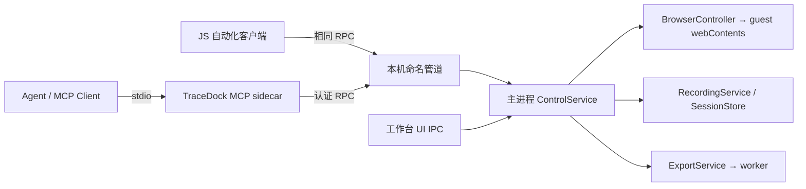

# Agent 控制、MCP 与 Playwright 接入方案

状态：2026-10-29 调研与隔离原型验证。本文没有把 MCP 或远程控制功能接入生产程序；当前差分导出实现由独立工作项完成。

## 建议结论

可以让 Agent 连接 TraceDock，操作内嵌网页、控制录制、读取时间线并取得导出文件。推荐先建立主进程业务服务，再提供本机 MCP stdio sidecar。浏览器操作固定指向 TraceDock 持有的 `WebContentsView.webContents`；录制和导出调用服务接口，不依赖宿主界面按钮的 DOM 选择器。

MCP 与 Playwright 承担不同职责：MCP 是 Agent 发现和调用工具的协议；Playwright 是网页操作的一种实现或测试适配。首版 MCP 能力不必依赖 Playwright 成功枚举每个 Electron target。Electron 的 `WebContentsView` 提供明确的 `webContents` 引用，主进程可以据此控制正确的内嵌页面。[Electron WebContentsView](https://www.electronjs.org/docs/latest/api/web-contents-view)

## 当前代码可复用的部分

- `src/main.cjs` 已有导航、录制状态机、快照检查点与导出调度；`SessionStore` 提供会话、分页与事件读取。
- `src/shell-preload.cjs` 的 `collector` 只给可信工作台页面使用。保留此边界，不将它注入被采集网页，也不把“让 Agent 在宿主页面执行 JS”作为公共 API。
- `scripts/smoke.cjs` 通过 Playwright `_electron.launch` 启动独立实例，证明开发/目录版可执行真实网页交互；这属于测试能力，尚不是外部 Agent 可接入的正式协议。
- 当前 UI 导出先调用原生保存对话框。Agent 导出应复用后面的截点/worker/原子提交逻辑，并将目的路径选择移出业务服务；无需自动点击系统保存对话框。
- 差分导出的任务进度、取消、结果以及时间线 cursor 可直接成为 Agent 工具的底层能力，避免另一套状态机。

## 推荐架构



建议模块拆分为 `control-service.cjs`、`browser-controller.cjs`、`recording-service.cjs`、`export-service.cjs` 和 `agent-transport.cjs`。UI IPC 与本机 RPC 只做输入校验和调用，不复制业务实现。Sidecar 负责 MCP schema、工具结果与生命周期，崩溃后可以重启，不必退出正在录制的桌面程序。

MCP stdio 由客户端启动服务子进程，stdin/stdout 只传协议消息，日志输出到 stderr；不需要为它开启 TCP 监听端口。这与本地桌面应用的使用方式匹配。[MCP transports](https://modelcontextprotocol.io/specification/2025-11-25/basic/transports)、[官方 TypeScript SDK](https://ts.sdk.modelcontextprotocol.io/server)

Windows 侧使用按应用实例区分的命名管道，sidecar 通过用户配置的实例描述定位它。正式实现需验证同用户访问控制，并使用随机连接令牌和协议版本握手；令牌不放进网页、时间线、日志或导出包。原型只验证了随机令牌校验，**没有验证 Windows ACL、跨用户访问或正式分发配置**。默认不监听公网端口。应用可显示当前连接和正在执行的操作，并提供断开/停止控制入口；操作授权沿用用户对当前 Agent 任务的授权范围。

## 三种路径比较

| 路径 | 优点 | 限制与建议 |
| --- | --- | --- |
| stdio sidecar + 本机 RPC | 连接已运行实例；与 UI 共用业务服务；日志与协议隔离；不需要 HTTP 端口 | 需要分发 sidecar、实例发现和认证；推荐作为首个正式入口 |
| MCP 直接嵌入 Electron | 服务可直接访问内部对象 | GUI 的 stdout 生命周期、单实例转发和多客户端管理更复杂；若采用 Streamable HTTP，还要维护端口、认证与 Origin 校验 |
| 仅暴露 Chromium CDP | 可复用部分 Playwright 网页操作 | CDP 没有 TraceDock 的录制/导出业务语义，也不能把页面 target 映射问题视为已解决；适合明确启用的调试/兼容模式 |

若后续增加 Streamable HTTP，本机绑定应限于 loopback，并按规范做 Origin 校验和认证；不能以“只在本机运行”为由省略这些处理。[MCP transports](https://modelcontextprotocol.io/specification/2025-11-25/basic/transports)

## Playwright 与 WebContentsView 的实测边界

这里存在两组不同证据，不能把其中一组推广为普遍结论。

1. 之前便携版验收的 `output/playwright/portable-targets.json` 中，`/json/list` 列出了工作台和内嵌演示页两个 page target，但 Playwright `browser.contexts().pages()` 只包含工作台。`portable-summary.json` 因此明确将 guest 验证记为 `snapshot-proof-through-preload-and-ipc`。准确结论是该次 Playwright Page 枚举没有暴露 guest，**不是 Chromium CDP 完全看不到它**。
2. 本次 `output/agent-control/` 隐藏、独立的 Electron 原型使用持久化分区的 WebContentsView。在 guest 创建前、创建后连接 CDP，两次均能得到 guest Playwright Page，并成功执行 `locator.click()`；点击计数增长且 `event.isTrusted === true`。
3. 同一原型还证明了认证命名管道请求可以到达主进程，再通过指定 guest 的 `webContents.debugger` 执行 CDP 点击；错误令牌被拒绝，guest 中 `typeof require` 和 `typeof window.collector` 都是 `undefined`。

两种枚举行为的具体差异原因尚未定位，不应直接归因于启动时序、持久化分区或 NSIS。正式 Playwright 接入需在实际便携 EXE 中复测目标枚举、加载时序、重连、导航、iframe 与不同版本。原型没有加载当前生产代码、没有使用用户真实会话，也没有执行生产导出测试。

原型命令与结果：

```powershell
node output\agent-control\probe.cjs
$env:PROBE_CONNECT_EARLY = '1'
node output\agent-control\probe.cjs
```

结果分别保存在 `probe-result-ready.json`、`probe-result-early.json`。使用 Electron 45.1.0 / Playwright 1.64.1；临时 CDP 端口只用于原型，原型结束即退出。

Playwright 官方将 Electron 支持列为 experimental；公开 Electron 入口为 `launch`，不能将它描述为可直接 attach 到任意已启动便携版。官方也说明 `connectOverCDP` 比 Playwright 协议连接保真度低。[Playwright Electron](https://playwright.dev/docs/api/class-electron)、[connectOverCDP](https://playwright.dev/docs/api/class-browsertype#browser-type-connect-over-cdp)

建议初期提供两个明确入口：

- **正式 Agent 入口**：MCP/JS 客户端调用主进程服务；browser controller 固定使用已知 guest，不向外提供任意 Electron 对象求值。
- **Playwright 适配入口**：测试环境继续 `_electron.launch`；已运行应用的 CDP 连接需显式启用、返回 guest target 身份并做版本验收。只有确认该 target 对应可用 Page 后，才交给调用者使用 locators；失败返回明确的 capability 不可用，不默默操作工作台。

不建议构造假的 Playwright BrowserContext 或依赖其私有 `_connection` 字段绕过枚举。也不应声称简单 `executeJavaScript('element.click()')` 等价于 Playwright 点击；两者的事件可信度、可操作性检查和等待行为不同。

## 建议的最小工具契约

所有工具返回结构化结果，含 `instanceId`；涉及网页操作再含 `documentId`/`navigationId`，避免导航后复用旧元素。输入和输出使用 JSON Schema，错误含稳定 code、message 和是否可重试。MCP 支持工具 schema 与结构化结果；以下工具名属于本项目建议。[MCP tools](https://modelcontextprotocol.io/specification/2025-11-25/server/tools)

| 工具 | 主要输入 | 主要输出与行为 |
| --- | --- | --- |
| `tracedock_state` | 可选 instanceId | 当前页面、录制状态、导出状态、支持的能力与版本 |
| `tracedock_navigate` | url、等待条件、timeoutMs | 导航 ID、最终 URL、加载状态；沿用 HTTP/HTTPS 与本地演示页规则 |
| `tracedock_observe` | documentId、范围、数量/字节上限 | 有界页面/可访问性摘要、可操作元素引用、覆盖信息 |
| `tracedock_browser_action` | documentId、frame、元素引用/locator、click/fill/press/select/scroll/wait | 操作结果、实际目标与更新后的页面身份 |
| `tracedock_recording` | start/pause/resume/stop/snapshot、sessionId、名称 | 新状态与关键事件 seq；非法状态转换明确拒绝 |
| `tracedock_timeline` | sessionId、beforeSeq/afterSeq、snapshotSeq、type/query、limit | 有界摘要页、total、hasMore、下一 cursor；不返回整个会话 |
| `tracedock_event` | sessionId、eventId、maxBytes | 有界详情预览、总字节数与是否截断；完整内容经导出读取 |
| `tracedock_export` | sessionId、encoding、compression、导出目录内文件名 | 立即返回 operationId；默认 delta + deflate，不弹保存对话框 |
| `tracedock_operation` | operationId、可选 waitMs | 阶段、已处理字节、总量、状态；成功时返回文件绝对路径、字节数、SHA-256 |
| `tracedock_cancel` | operationId | 取消请求与最终状态；已完成时返回已完成，不删除结果 |

首版可以只提供主 frame 的 click/fill/press/scroll，加上必要的元素解析与等待；iframe、上传、下载、多窗口和任意脚本执行应分别声明能力。它们不是“支持 CDP”就自动完备。浏览器动作需要唯一目标、可见/可用检查、稳定坐标、命中测试和超时；如果自行实现 CDP adapter，应按其已实现能力描述，不能宣称拥有 Playwright 的全部自动等待。[Playwright actionability](https://playwright.dev/docs/actionability)

主进程的 Debugger API 是针对特定 WebContents 的 CDP 传输，可用于 DOM/可访问性读取与输入分发。需要处理 detach、页面销毁、导航和 DevTools 打开导致的连接变化。[Electron Debugger](https://www.electronjs.org/docs/latest/api/debugger)

## 导出与大结果交付

将当前原生保存对话框保留在 UI adapter。`ExportService.start` 接收已解析的目的路径和 options，由 UI 与 Agent 共用；Agent 默认写入用户配置的导出目录，工具只接收目录内名称，不开放任意文件读取或覆盖范围。沿用固定截点、worker、有界读取、取消清理与原子提交。

长任务优先返回 operationId，由 `tracedock_operation` 查询或短时等待。不能在 `tracedock_export` 已返回后继续把普通 MCP request 的 progressToken 当作活跃请求；首版无需依赖各 Agent 对 MCP Tasks 的支持。若提供等待型工具，则只在该请求活跃期间发送 progress 通知，并保证数值单调递增，阶段切换时不把百分比重置回零。[MCP progress](https://modelcontextprotocol.io/specification/2025-11-25/basic/utilities/progress)

MCP 取消通知适用于仍在运行的请求；已返回 operationId 的后台导出通过明确的 `tracedock_cancel` 取消。取消与完成竞态要返回实际最终状态，不能把已经提交的 ZIP 说成未生成。[MCP cancellation](https://modelcontextprotocol.io/specification/2025-11-25/basic/utilities/cancellation)

同机 Agent 优先获得绝对路径、SHA-256 和 Agent 说明入口，不把大 ZIP 作为 base64 塞入一次工具响应。需要文件内容的客户端可另外提供只限该导出结果的分块读取，且对响应字节数设上限；云端 Agent 是否能访问本机路径必须单独判断，不能以返回路径代替上传成功。

## 最小落地顺序与验收

1. 抽出主进程服务，保持现有 UI 与导出行为通过原验收；业务命令参数验证、录制命令序列化与长导出 worker 边界集中维护。
2. 实现实例发现、认证本机 RPC、只读 state/timeline/event，验证错误令牌、错误实例、断线与重连。
3. 增加导航、观察、有限网页动作和录制工具；每个动作记录关联 requestId、documentId 与结果。人工操作仍由原采集器观察，不能与 Agent 命令制造重复事件。
4. 增加无需 UI 对话框的导出启动、查询、取消、文件结果；验证导出期间暂停/结束不被阻塞，断开 Agent 不破坏已落盘记录，文件结果可用随包脚本还原。
5. 提供 MCP stdio sidecar 和安装配置示例，完成真实 MCP 客户端握手/工具发现/调用验收。原型只验证内部 RPC 和网页操作，尚未验证完整 MCP 握手或客户端兼容性。
6. 最后单独验收正式便携版 Playwright target 映射与重连，再公开其能力。关键用例包含多次导航、同源 iframe、SPA、关闭/重建 guest、DevTools 并存和不同 Electron/Playwright 版本。

页面与时间线文本是观察数据，不是对 Agent 的控制指令。接入只增加自动化控制通道，不扩大已有采集覆盖、不引入数据脱敏，也不改变差分还原的事实一致性要求。
